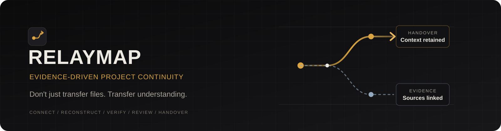
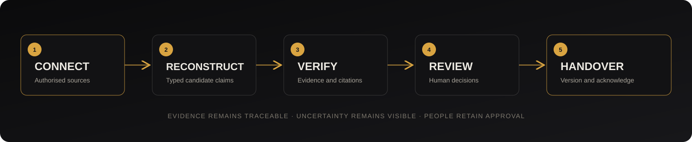
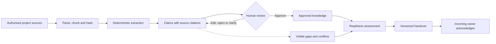
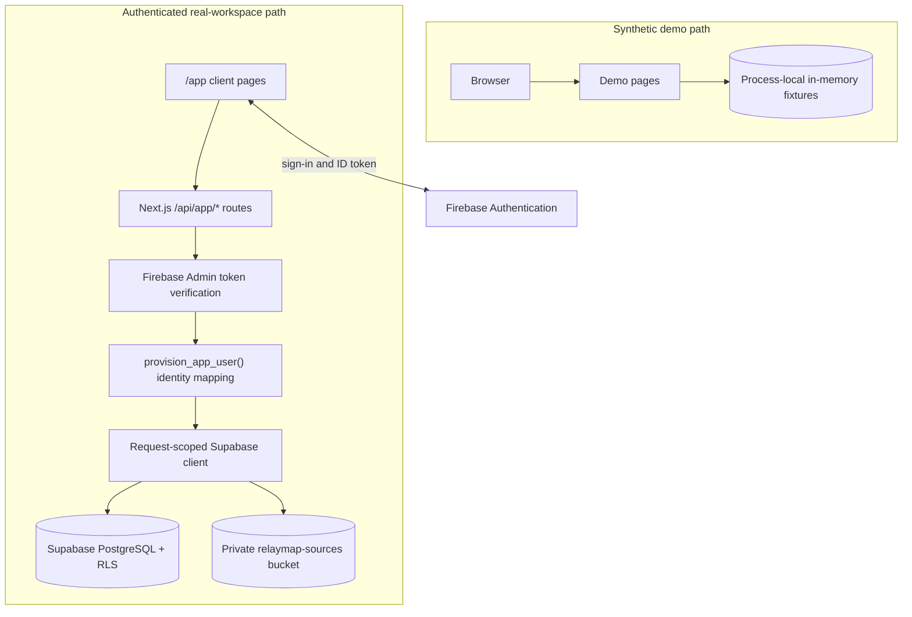

<p align="center">
  
</p>

<h1 align="center">RELAYMAP</h1>
<p align="center"><strong>Evidence-Driven Project Continuity Platform</strong></p>
<p align="center"><em>Don't just transfer files. Transfer understanding.</em></p>

<p align="center">
  <a href="https://relaymapnowlive.vercel.app/"><strong>Open demo preview</strong></a>
  &nbsp;·&nbsp;
  <a href="https://github.com/JayeshJadhav28/relaymap"><strong>View source</strong></a>
  &nbsp;·&nbsp;
  <a href="https://github.com/JayeshJadhav28/relaymap/issues"><strong>Report an issue</strong></a>
</p>

<p align="center">
  <a href="https://github.com/JayeshJadhav28/relaymap/stargazers"></a>
  <a href="https://github.com/JayeshJadhav28/relaymap/network/members"></a>
  <a href="https://github.com/JayeshJadhav28/relaymap/issues"></a>
  <a href="https://github.com/JayeshJadhav28/relaymap/commits/main"></a>
  <a href="https://github.com/JayeshJadhav28/relaymap"></a>
  <a href="LICENSE"></a>
</p>

<p align="center">
  
  
  
  
  
  
  
</p>

---

Project knowledge is rarely lost all at once. It leaks: a decision recorded only in a chat thread, a task whose owner has left, a deployment target mentioned in one document and contradicted in another, or an unwritten rationale that only made sense to the person who wrote it.

**RELAYMAP** reconstructs project context from source material, binds claims to supporting evidence, keeps uncertainty visible and prepares permission-aware handovers for incoming owners.

> [!IMPORTANT]
> **Synthetic demo data:** The included CampusConnect workspace is fictional. It is not customer, institutional or production data. Do not upload confidential or personal information to the demo.

> [!NOTE]
> The demo preview URL above is the project-provided deployment address. Its availability and hosted real-workspace integrations have not been independently verified as part of this README update. A successful page load or health response alone would not prove Firebase, Supabase, RLS or Storage connectivity.

## Contents

- [What is RELAYMAP?](#what-is-relaymap)
- [Product workflow](#product-workflow)
- [Core capabilities](#core-capabilities)
- [Demo mode vs real workspace mode](#demo-mode-vs-real-workspace-mode)
- [Architecture](#architecture)
- [Technology stack](#technology-stack)
- [Repository structure](#repository-structure)
- [Quick start](#quick-start)
- [Environment configuration](#environment-configuration)
- [Database and migrations](#database-and-migrations)
- [Testing](#testing)
- [Deployment](#deployment)
- [Security and privacy](#security-and-privacy)
- [Known limitations](#known-limitations)
- [Roadmap](#roadmap)
- [Team](#team)
- [License](#license)

## What is RELAYMAP?

RELAYMAP is an evidence-driven, permission-aware project knowledge handover platform. It turns scattered project records into a structured, reviewable knowledge base that helps the next owner understand:

- **What happened?** Decisions, tasks, risks and project changes.
- **Why did it happen?** The rationale and source material behind a claim.
- **Who owns it?** Recorded responsibilities and knowledge concentration.
- **What remains?** Unfinished work, blockers and unresolved questions.
- **What depends on it?** Recorded relationships between decisions, claims and tasks.
- **What should happen next?** Evidence-backed next actions and a role-aware handover.

The system does not guarantee complete reconstruction. Extraction is deterministic and rule-based. Unsupported, contradictory or incomplete material remains visible for human review rather than being silently promoted into fact.

### Product preview

The workflow graphic below is an original project diagram, not a screenshot of the running application.

<p align="center">
  
</p>

Application screenshots are not currently included in the public repository. Add genuine captures under `docs/assets/` when they are available; do not use mock screens as evidence of implemented functionality.

## Product workflow

RELAYMAP follows five connected stages:

| Stage | What happens |
|---|---|
| **Connect** | A member provides authorised project sources. Files are validated, parsed, chunked and hashed. |
| **Reconstruct** | Ordered deterministic rules identify candidate decisions, tasks, owners, dependencies, risks, blockers, questions and information gaps. |
| **Verify** | Claims are linked to exact source chunks and quotations. Citation integrity is validated before a claim can be approved. |
| **Review** | An authorised reviewer edits, approves, rejects, resolves conflicts or requests clarification. Review history is append-only. |
| **Handover** | A lead prepares a role-aware draft. Publishing snapshots the permitted claims and readiness state; the incoming member acknowledges a specific version. |



**Evidence traceability is the central constraint.** A claim must point to a real source and chunk. The quoted text is checked against the stored chunk. A role that cannot access a source must not receive claims that depend on that source with the evidence stripped away; restricted claims are excluded during assembly.

## Core capabilities

The table describes the public codebase's documented implementation scope. “Implemented” does not mean that every hosted integration has been exercised in a live Firebase and Supabase environment.

| Capability | Status | Notes |
|---|---|---|
| Synthetic CampusConnect demo | Implemented | Fictional fixtures in a process-local in-memory store. |
| Organisation and project management | Implemented | Real-workspace services and database-backed membership model. |
| Invitations | Implemented | Scoped, hashed, single-use and expiring tokens. Email delivery is not implemented. |
| Source ingestion | Implemented | `.txt`, `.text`, `.md`, `.markdown`, `.csv`, `.json`, `.pdf` and `.docx`; 2 MiB and 500,000-character limits. |
| Parsing, chunking and hashing | Implemented | PDF page ranges are retained where available; DOCX does not receive invented page numbers. |
| Claim extraction | Implemented | Deterministic rules identify supported decisions, tasks, ownership, dependencies, risks, blockers, questions and gaps. |
| Evidence binding | Implemented | Claims cite exact source chunks; quote text and hash are checked. |
| Knowledge relationships | Implemented | Typed relationships and bounded graph traversal in the domain layer. |
| Human review | Implemented | Approve, reject, edit, resolve conflict, request clarification and mark inferred. Review records are append-only. |
| Conflict handling | Implemented | Contradictory deployment statements can be grouped for human resolution. |
| Readiness assessment | Implemented | Shared deterministic calculation; includes evidence, review, ownership, conflict, next-action and acknowledgement components. |
| Impact analysis | Partially exposed | Demo API and bounded graph traversal exist; impact analysis is not exposed in the real-workspace UI. |
| Handover drafting and versioning | Implemented | Scribe assembles a draft from authorised records; it does not approve or publish. |
| Handover export | Implemented | Print-friendly HTML for a specific handover version. |
| Acknowledgement | Implemented | Incoming users acknowledge an exact published version; acknowledgement grants no write access. |
| Incoming-owner questions | Implemented | Deterministic questions for missing rationale, ownership, conflicts, missing evidence and knowledge concentration. |
| Audit history | Implemented | Review, publish, acknowledge and administration events are recorded. |
| Permission-aware access | Implemented | Organisation role, project role and finance clearance are enforced through database RLS. |
| Finance-sensitive visibility | Implemented | Finance sources and claims citing them are redacted before response or handover assembly. |
| AskBuddy evidence retrieval | Implemented | Deterministic retrieval over recorded claims and citations; not a generative model. |
| GitHub project intelligence | Foundation only | Server-only GitHub client and analysis helpers exist, but there is no user-facing repository connection route or UI in this build. |
| AI-assisted extraction or answering | Not implemented | No LLM provider, model API key or prompt pipeline is used. |

## Demo mode vs real workspace mode

RELAYMAP has two deliberately separate execution paths. They share types and pure domain logic, but the synthetic demo does not read or write real workspace rows.

| Property | Synthetic demo | Real workspace |
|---|---|---|
| Entry point | `/` and `/dashboard` | `/app` |
| Identity | No authenticated identity; a preview cookie selects a demo role for filtering. | Firebase Authentication; server-verified ID token required for API requests. |
| Data store | Process-local in-memory store on `globalThis`, rebuilt from fixtures. | Supabase PostgreSQL with row-level security. |
| File storage | Synthetic fixtures. | Private Supabase Storage bucket `relaymap-sources`. |
| Persistence | Resets when the Node.js process restarts; instances do not share state. | Database-backed, subject to cloud configuration. |
| Cloud configuration | None required. | Firebase web/Admin configuration and Supabase URL/publishable key. |
| Failure behaviour | Demo remains separate from cloud data. | Returns an error when real services are unavailable; it does not substitute demo data. |

### Synthetic demo

The demo reconstructs a fictional **CampusConnect** student-transit project.

- **Preview roles:** `lead`, `reviewer`, `treasurer` and `incoming`.
- **Role switching:** `POST /api/role` sets the `relay_role` preview cookie. This is a demo preview control, not authentication.
- **Reset:** `POST /api/reset` restores the original fixtures, reviews and audit events. The reset endpoint is available only in demo mode.
- **Finance preview:** finance sources and claims citing them are hidden from roles without finance visibility.
- **Persistence:** state is held in memory for the lifetime of a server process. Restarting the process resets the demo; multiple server instances do not share state.
- **Isolation:** the demo never reads or writes Supabase, even when cloud credentials are configured. Setting `RELAY_DEMO_MODE=false` disables demo role switching and reset; it does not activate or deactivate the real workspace.

### Real workspace

The real application is separate under `/app`.

1. The browser signs in through **Firebase Authentication**.
2. The browser sends a Firebase ID token to the Next.js API.
3. **Firebase Admin** verifies the token server-side, including signature and configured project audience.
4. A request-scoped Supabase client forwards that caller's Firebase ID token.
5. The `provision_app_user()` RPC maps the verified Firebase UID to an internal `app_users` record.
6. Domain services read or write through the caller-scoped client.
7. **PostgreSQL RLS** enforces organisation membership, project role and finance clearance.

The server-only Supabase secret key is reserved for operational tooling. It is not used to answer ordinary user requests.

Email verification is optional in the current implementation. A newly registered account can reach `/app` without confirming the address. This is a development trade-off, not a recommendation for an unrestricted public sign-up flow.

Hosted Firebase authentication, hosted Supabase RLS, hosted Storage and cross-tenant isolation must be independently verified in the target cloud projects before treating the real-workspace path as production validated.

## Architecture

RELAYMAP is one Next.js application with a shared TypeScript domain layer. The synthetic demo and authenticated real workspace have separate runtime paths.



### Main layers

| Layer | Location | Responsibility |
|---|---|---|
| Pages and route handlers | `src/app/**` | UI composition, navigation and HTTP contracts. |
| Components | `src/components/**` | Shared interface, review, source and handover components. |
| API validation | `src/lib/api/**` | Zod request validation and safe error mapping. |
| Real workspace services | `src/lib/real/**` | Authorised Supabase reads and writes. |
| Identity | `src/lib/firebase/**` | Browser authentication and server-side token verification. |
| Supabase access | `src/lib/supabase/**` | Browser, server and request-scoped clients. |
| Domain | `src/lib/domain/**` | Citation validation, redaction, readiness, handover and graph rules. |
| Extraction | `src/lib/extraction/**` | Ordered deterministic extraction rules. |
| Agents | `src/lib/agents/**` | Scribe draft assembly, gap questions and evidence retrieval. These are deterministic modules, not LLM agents. |
| Ingestion | `src/lib/ingestion/**` | Binary-aware document parsing, normalisation and chunking. |
| GitHub foundation | `src/lib/github/**` | Server-only GitHub REST client and analysis helpers; not wired to a user-facing route/UI. |
| Database | `supabase/migrations/**` | Schema, constraints, RLS policies, RPCs and storage policies. |

### Evidence and extraction details

- Supported text inputs include `.txt`, `.text`, `.md`, `.markdown`, `.csv` and `.json`.
- PDF and DOCX files are handled as binary uploads, with file-signature checks before parsing.
- PDF page ranges are retained where the format provides page boundaries.
- DOCX does not have fixed page pagination; the parser does not invent page numbers.
- Scanned PDFs requiring OCR are not processed by this build.
- Maximum upload size is 2 MiB; extracted text is limited to 500,000 characters.
- Content hashes and stable chunk offsets support source traceability.
- Unsupported or unrecognised material is not automatically turned into a verified claim.

### Readiness model

The shared domain calculation uses the following 100-point weighting:

| Component | Weight |
|---|---:|
| Evidence coverage | 25 |
| Review completion | 25 |
| Ownership coverage | 15 |
| Conflict resolution | 15 |
| Critical next actions | 10 |
| Incoming-member acknowledgement | 10 |
| **Total** | **100** |

The readiness score is a signal, not a guarantee of successful knowledge transfer. Reasons are returned for each component.

## Technology stack

Versions below reflect the public `package.json` and project configuration at the time this README was prepared.

| Technology | Version / target | Use |
|---|---|---|
| Next.js App Router | 16.4.3 | Application pages, route handlers and standalone server output. |
| React | 19.3.1 | UI rendering. |
| TypeScript | 5.9.3 | Application and domain types. |
| Node.js | `>=22.0.0` | Runtime. |
| pnpm | 10.x | Package management; Docker activates 10.11.0. |
| Tailwind CSS | 4.3.3 | Styling dependency; current UI also uses a custom stylesheet. |
| Firebase JS SDK | 13.x | Browser authentication and ID tokens. |
| Firebase Admin SDK | 14.x | Server-side identity verification and provisioning support. |
| Supabase JS | 2.118.0 | PostgreSQL/PostgREST and Storage access. |
| PostgreSQL | 17 | Database schema, constraints, RLS and RPCs. |
| Zod | 4.6.7 | Request validation. |
| Mammoth | 1.13.0 | DOCX text extraction. |
| unpdf | 1.9.1 | PDF text extraction and page ranges. |
| Vitest | 4.1.5 | Unit and domain tests. |
| Playwright | 1.65.0 | Browser regression test specifications. |
| ESLint | 9.39.2 | Static analysis. |

No external AI model provider is used in this build. The extraction engine, Scribe, Interviewer and Buddy modules use deterministic application logic.

## Repository structure

```text
relaymap/
├── src/
│   ├── app/
│   │   ├── (auth)/                 # Authentication pages
│   │   ├── (workspace)/            # Synthetic demo workspace
│   │   ├── app/                    # Real authenticated workspace
│   │   └── api/                    # Demo, auth and real-workspace routes
│   ├── components/                 # UI, review, source and handover components
│   └── lib/
│       ├── agents/                 # Scribe, Interviewer and Buddy logic
│       ├── api/                    # Request schemas and HTTP helpers
│       ├── demo/                   # Synthetic fixtures and in-memory store
│       ├── domain/                 # Evidence, graph, readiness and handover rules
│       ├── extraction/             # Deterministic extraction engine and rules
│       ├── firebase/               # Firebase browser/Admin integration
│       ├── github/                  # GitHub foundation library
│       ├── handover/               # Handover report generation
│       ├── ingestion/              # Document parser and chunking
│       ├── real/                   # Authenticated workspace services
│       └── supabase/               # Supabase client configuration
├── supabase/
│   ├── migrations/                 # 11 ordered SQL migrations
│   └── tests/local/                # PostgreSQL harness and SQL assertions
├── tests/browser/                  # Playwright browser test specifications
├── scripts/                        # Build preparation and UI snapshot utility
├── docs/assets/                    # README banner and workflow graphics
├── .env.example                    # Value-free environment template
├── Dockerfile
├── LICENSE
├── README.md
├── next.config.ts
├── package.json
├── pnpm-lock.yaml
└── vitest.config.mts
```

The `documentation/` and `.opencode/` directories are intentionally excluded from the public repository. `scripts/ui-snapshots.mjs` writes captures under the local `documentation/` tree; those captures are not automatically published.

## Quick start

The synthetic demo runs locally without Firebase or Supabase credentials.

### Prerequisites

- Node.js `>=22.0.0`
- pnpm 10.x
- Git

Docker is optional. It is required for the disposable PostgreSQL migration/RLS harness and for building the container image.

### Install and run

```bash
git clone https://github.com/JayeshJadhav28/relaymap.git
cd relaymap
pnpm install
pnpm dev
```

Open [http://localhost:3000](http://localhost:3000).

The synthetic CampusConnect demo is available without a `.env.local` file.

### Production build

```bash
pnpm build
pnpm start:standalone
```

The build creates Next.js standalone output and runs `scripts/prepare-standalone.mjs` to copy static assets into the standalone directory.

## Environment configuration

Copy the value-free template:

```bash
cp .env.example .env.local
```

On Windows PowerShell:

```powershell
Copy-Item .env.example .env.local
```

The demo does not require these values. The real workspace does.

### Application

| Variable | Scope | Purpose |
|---|---|---|
| `RELAY_DEMO_MODE` | Server | Demo is enabled unless this is set to `false`. |

### Firebase web configuration

These values identify the Firebase web application. They do not authorise requests by themselves.

| Variable | Scope | Required for real path |
|---|---|---|
| `NEXT_PUBLIC_FIREBASE_API_KEY` | Browser | Yes |
| `NEXT_PUBLIC_FIREBASE_AUTH_DOMAIN` | Browser | Yes |
| `NEXT_PUBLIC_FIREBASE_PROJECT_ID` | Browser | Yes |
| `NEXT_PUBLIC_FIREBASE_APP_ID` | Browser | Yes |
| `NEXT_PUBLIC_FIREBASE_MESSAGING_SENDER_ID` | Browser | Optional for current functionality |

### Firebase Admin configuration

Server-only and sensitive. Provide the explicit service-account fields or use an application credentials file.

| Variable | Scope | Required for real path |
|---|---|---|
| `FIREBASE_ADMIN_PROJECT_ID` | Server only | Yes, unless using credentials file |
| `FIREBASE_ADMIN_CLIENT_EMAIL` | Server only | Yes, unless using credentials file |
| `FIREBASE_ADMIN_PRIVATE_KEY` | Server only, sensitive | Yes, unless using credentials file |
| `GOOGLE_APPLICATION_CREDENTIALS` | Server only, sensitive | Alternative credentials-file path |

### Supabase configuration

| Variable | Scope | Required for real path |
|---|---|---|
| `NEXT_PUBLIC_SUPABASE_URL` | Public | Yes |
| `NEXT_PUBLIC_SUPABASE_PUBLISHABLE_KEY` | Public | Yes |
| `SUPABASE_SECRET_KEY` | Server only, sensitive | Operational tooling only |

The publishable key is used with the caller's Firebase ID token, so database RLS remains applicable. The secret key is not used for ordinary user requests.

> [!CAUTION]
> Never commit `.env.local`, Firebase Admin service-account JSON, private keys, database passwords, `SUPABASE_SECRET_KEY` or invitation tokens. If a credential is exposed, rotate it and revoke the old value.

There are no AI-provider environment variables in this build. `GITHUB_TOKEN` is read by the server-only GitHub library, but that library is not connected to a user-facing GitHub feature.

## Database and migrations

RELAYMAP targets PostgreSQL 17 with Supabase-compatible policies and functions. Migrations are applied in filename order from `supabase/migrations/`. There are **11 migrations** in the current public directory.

| # | Migration | Purpose |
|---:|---|---|
| 1 | `202610300001_relay_foundation.sql` | Core profiles, organisations, projects, sources, knowledge, reviews, handovers and audit schema. |
| 2 | `202611070001_relaymap_identity_rls.sql` | Organisation/project roles, finance clearance, invitations and RLS baseline. |
| 3 | `202611070002_relaymap_sources_evidence.sql` | Source hashes, chunks and citation-to-chunk validation. |
| 4 | `202611070003_relaymap_claims_graph.sql` | Claim fields, knowledge relationships and append-only review enforcement. |
| 5 | `202611070004_relaymap_handover_audit.sql` | Handover versions, version claims, questions, readiness snapshots and audit hardening. |
| 6 | `202611070005_relaymap_github.sql` | GitHub connection records and server-only analysis/run schema; not a complete product integration. |
| 7 | `202611070006_relaymap_demo_seed.sql` | Explicit, idempotent demo seed function. |
| 8 | `202611100001_relaymap_firebase_identity.sql` | Firebase UID to internal `app_users` identity bridge. |
| 9 | `202611100002_relaymap_storage.sql` | Private `relaymap-sources` bucket and path-derived storage policies. |
| 10 | `202611100003_relaymap_invitations_acknowledgement.sql` | Project-scoped invitations and acknowledgement policies. |
| 11 | `202611110001_relaymap_optional_email_verification.sql` | Optional email-verification behaviour. |

### Local PostgreSQL validation harness

The PowerShell harness creates or reuses a disposable PostgreSQL 17 container, applies bootstrap SQL and migrations in filename order, runs constraint/RLS assertions and exercises demo-seed idempotency.

```powershell
powershell.exe -NoProfile -ExecutionPolicy Bypass -File supabase\tests\local\run.ps1
```

This harness uses auth stubs. It does not run GoTrue, PostgREST, Realtime or Supabase Storage, and it is not a hosted Supabase integration test.

### Hosted migration workflow

After linking a Supabase project:

```bash
supabase link --project-ref <project-ref>
supabase db push
```

Review and back up before applying migrations to a hosted database. Do not run `supabase db reset` against a hosted project.

## Testing

The following scripts are defined in `package.json`:

| Command | Purpose |
|---|---|
| `pnpm typecheck` | TypeScript check with `tsc --noEmit`. |
| `pnpm lint` | ESLint across the repository. |
| `pnpm test` | Vitest unit and domain test suites. |
| `pnpm test:browser` | Playwright browser suite under `tests/browser`. |
| `pnpm build` | Next.js production build and standalone preparation. |
| `pnpm audit --prod` | Production dependency audit using pnpm's audit command. |

The public repository contains browser test specifications, but `playwright.config.ts` is excluded by the current `.gitignore`. A clean clone may therefore need a local Playwright configuration before `pnpm test:browser` can run.

The local PostgreSQL harness requires Docker and is separate from hosted Firebase/Supabase verification. Tests that use local auth stubs do not prove hosted GoTrue, PostgREST, Storage or cross-tenant behaviour.

## Deployment

### Demo preview

[Open the RELAYMAP preview](https://relaymapnowlive.vercel.app/)

This is the deployment URL supplied for the project. Confirm availability and real-workspace integrations in the target environment before treating them as verified. The previously mentioned `ith.relaymap.io` address is not used here because it is not the repository's current homepage value.

### Vercel

- Import `JayeshJadhav28/relaymap`.
- Set the repository root as the project root.
- Use the Next.js framework preset.
- Configure Firebase and Supabase environment variables for each required deployment environment.
- Add the deployed hostname to Firebase Authentication's authorised domains.
- Configure Firebase as a third-party auth provider in Supabase.

Set `PORT` if required by the host. Use `/api/health` as a process liveness endpoint only; a healthy response is not proof of successful Firebase or Supabase authentication.

### Docker

The repository includes a multi-stage standalone Dockerfile.

```bash
docker build -t relaymap:local .
docker run --rm -p 3000:3000 --env-file .env.local relaymap:local
```

The image uses Node 22 Alpine, activates pnpm 10.11.0, builds the standalone Next.js output and runs as a non-root user. Runtime secrets are provided through environment variables, not baked into the image.

## Security and privacy

| Boundary | Security model |
|---|---|
| Browser → API | Firebase ID token is verified server-side. Client-supplied user, organisation, project, role and clearance values are not trusted. |
| API → Supabase | A request-scoped client forwards the caller's Firebase token. |
| Database | PostgreSQL RLS enforces organisation and project boundaries. |
| Finance visibility | Finance sources and claims citing them are filtered for users without finance clearance. |
| Storage | Source bucket is private; access is derived from organisation/project path segments. |
| Handover | Published versions are snapshots; acknowledgement is tied to an exact version. |

Other implemented controls include upload allow-lists, PDF/DOCX file-signature checks, a 2 MiB upload limit, a 500,000-character extraction limit, `Cache-Control: no-store` on API responses, and safe database error responses.

### Security gaps

The current project documentation identifies the following items as not implemented or not independently validated:

- Application-level rate limiting, CAPTCHA/bot protection and per-tenant quotas.
- A Content Security Policy (CSP).
- A WAF and automated secret scanning.
- MFA, passkeys and social sign-in.
- Hosted penetration testing or security certification.
- Hosted cross-organisation RLS and Storage verification.

Do not treat the above as completed security controls. Review deployment configuration and conduct appropriate security testing before an unrestricted public launch.

## Known limitations

- The CampusConnect demo is synthetic and process-local. It resets on process restart and is not shared across multiple server instances.
- Real-workspace flows require correctly configured Firebase and Supabase projects.
- Hosted sign-in, hosted RLS, hosted Storage, invitations and cross-tenant isolation have not been verified by the public repository alone.
- Email verification is optional in this build.
- Invitation email delivery is not implemented; invitation links need out-of-band delivery.
- GitHub support consists of schema and server-only library code; there is no user-facing repository connection or analysis UI in this build.
- No external AI model provider is used. Extraction, Scribe drafting, gap questions and Buddy retrieval are deterministic.
- Impact analysis is not exposed in the real-workspace UI.
- Scanned PDFs requiring OCR are not processed.
- Document parsing runs within the request; there is no background job runner.
- Account deletion and user data export workflows are not implemented.
- The public repository does not include the local `documentation/` implementation notes or a tracked Playwright configuration.

## Roadmap

The following three improvements preserve the original Round 1 roadmap. They are future development directions and should not be interpreted as fully delivered features.

### 1. GitHub Project Intelligence

- Authorised repository connection.
- Contributor activity analysis.
- Knowledge concentration analysis.
- Open pull requests and unfinished work.
- Cited technical explanations.
- Project knowledge-risk radar.

### 2. Decision Impact Knowledge Graph

- Connected decision/task graph.
- Dependency traversal.
- Supersession tracking.
- Downstream impact analysis.
- Interactive knowledge map.

### 3. Intelligent Guided Handover

- Interviewer workflow.
- Evidence-verifying Scribe.
- Incoming-member Buddy.
- Gap-driven clarification.
- Grounded handover Q&A.
- Knowledge verification and improved readiness.

## Team

**BHAKARWADI** · CodersInPune Hackathon 2026 · Organised by HackWithPune

| Member | Role |
|---|---|
| Jayesh Jadhav | Team Leader |
| Omkar Bhagat | Team Member |
| Atharva Gaikwad | Team Member |
| Amol Sable | Team Member |

## License

RELAYMAP is released under the [MIT License](LICENSE).

Copyright (c) 2026 Relay contributors.

---

<p align="center">
  <strong>Leave the project. Not the knowledge.</strong><br>
  <em>RELAYMAP — Don't just transfer files. Transfer understanding.</em>
</p>
