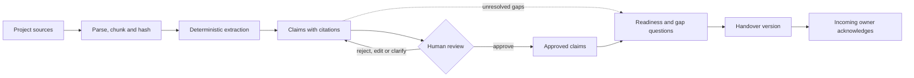
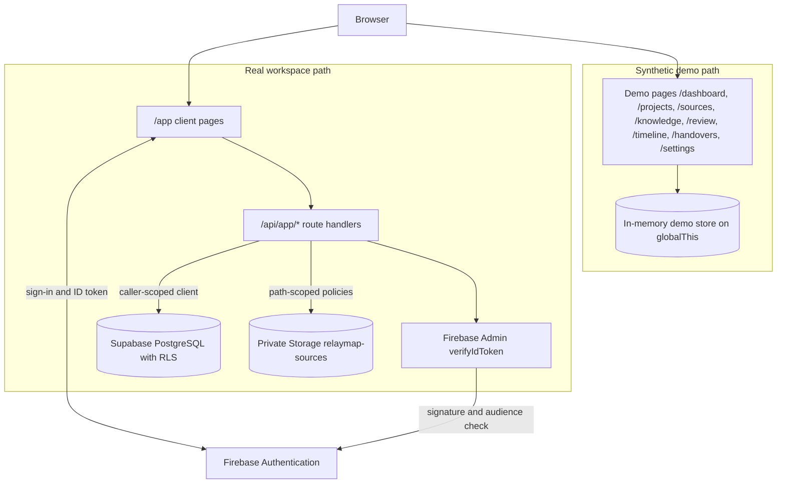

# RELAYMAP

**Evidence-Driven Project Continuity Platform**

Project knowledge is rarely lost all at once. It leaks: a decision recorded only
in a chat thread, a task whose owner has left, a deployment target mentioned in
one document and contradicted in another, an unwritten rationale that only made
sense to the person who wrote it. When ownership changes, the next person
inherits the artefacts but not the context.

RELAYMAP reconstructs project context from source material, binds every claim to
the evidence that supports it, and keeps unresolved gaps visible instead of
silently turning them into facts. The result is a reviewable knowledge base and a
permission-aware handover for the incoming owner.

The product workflow is:

`Connect → Reconstruct → Verify → Review → Handover`

RELAYMAP does not claim to understand every project record, and it does not
guarantee complete knowledge reconstruction. Extraction is deterministic and
rule-based; unsupported or contradictory material remains marked as unresolved
until a human reviews it.

> **Synthetic demo data.** The included CampusConnect workspace is fictional.
> It is not customer, institutional or production data. Do not upload
> confidential or personal information to the demo.

## Contents

- [Core capabilities](#core-capabilities)
- [How RELAYMAP works](#how-relaymap-works)
- [Demo mode vs real workspace mode](#demo-mode-vs-real-workspace-mode)
- [Technology stack](#technology-stack)
- [Architecture](#architecture)
- [Repository structure](#repository-structure)
- [Prerequisites](#prerequisites)
- [Local installation and startup](#local-installation-and-startup)
- [Environment configuration](#environment-configuration)
- [Database and migrations](#database-and-migrations)
- [Testing and quality checks](#testing-and-quality-checks)
- [Technical documentation](#technical-documentation)
- [Deployment](#deployment)
- [Security and privacy](#security-and-privacy)
- [Known limitations and project status](#known-limitations-and-project-status)
- [License and contributors](#license-and-contributors)

## Core capabilities

| Capability | Status | Notes |
|---|---|---|
| Synthetic demo workspace | Implemented | CampusConnect fixtures in a process-local, in-memory store. |
| Organisation and project management | Implemented | Real workspace; the database derives creator roles. |
| Invitations | Implemented | Organisation and optional project scope; hashed, single-use, expiring tokens. Email delivery is not implemented. |
| Source ingestion | Implemented | `.txt`, `.md`, `.markdown`, `.csv`, `.json`, `.pdf`, `.docx`; 2 MiB and 500,000-character limits. |
| Parsing, chunking and content hashing | Implemented | PDF page ranges are preserved where the format provides them. |
| Claim extraction | Implemented | Deterministic rules for decisions, tasks, ownership, dependencies, risks, blockers, questions and gaps. No external AI provider. |
| Evidence binding and citation validation | Implemented | Claims cite exact source chunks; the database checks the quoted snippet and its hash. |
| Knowledge relationships | Implemented | Typed relationships between claims and graph traversal in the domain layer. |
| Review workflow | Implemented | Approve, reject, edit, resolve conflict, request clarification and mark inferred. Reviews are append-only. |
| Conflict handling | Implemented | Contradictory deployment statements are grouped and surfaced for a human decision. |
| Readiness assessment | Implemented | Calculated in the shared domain; shown in the demo and snapshotted on real handovers. |
| Impact analysis | Implemented | Demo API and bounded graph traversal for downstream effects; not exposed in the real workspace UI. |
| Handover drafting and versioning | Implemented | The Scribe prepares a draft from authorised records and never approves or publishes it. |
| Handover export | Implemented | Print-friendly HTML report for a specific handover version. |
| Acknowledgement | Implemented | Incoming members acknowledge an exact published version; the record is auditable and grants no write access. |
| Incoming-owner questions | Implemented | Deterministic question generation for missing rationale, ownership, conflicts, missing evidence and knowledge concentration. |
| Audit history | Implemented | Review, publish, acknowledge and administration events are recorded. |
| Permission-aware access | Implemented | Organisation role, project role and finance clearance are enforced by database RLS, not only by the UI. |
| Finance-sensitive visibility | Implemented | Finance sources and every claim citing them are redacted before a response or handover draft is assembled. |
| Evidence retrieval assistant ("AskBuddy") | Implemented | Demo API with deterministic retrieval over existing claims and citations. It is not a generative model and says when evidence is insufficient. |
| GitHub integration | Foundation only | Database tables, a server-only library and tests exist; there is no user-facing GitHub route or UI in this build. |
| AI-assisted extraction or answering | Not implemented | No model provider, API key or prompt pipeline is present. |

"Implemented" means the workflow exists in the codebase and its domain rules are
covered by the local test suite. Several implemented capabilities only run end
to end once a Firebase project and a Supabase project are configured; those
dependencies are described in the sections that follow.

## How RELAYMAP works

1. **Connect.** A project member uploads source material. The parser detects the
   file type, extracts text, splits it into stable chunks and records a content
   hash.
2. **Reconstruct.** Ordered extraction rules identify candidate decisions,
   tasks, owners, dependencies, risks, blockers, questions and missing
   information. Each candidate is stored as a claim with a verification status,
   not as an established fact.
3. **Link evidence.** Every claim carries citations to a source and chunk. The
   citation quote must match the chunk exactly, and the database enforces that
   invariant on write.
4. **Verify and review.** A reviewer approves, rejects, edits, resolves a
   conflict, requests clarification or marks a claim inferred. Review records
   are append-only, so the history of a decision is preserved.
5. **Assess readiness.** Readiness combines approved claims, unresolved gaps,
   conflicts, missing evidence and ownership concentration. Gap questions are
   generated for the incoming owner.
6. **Hand over.** A lead assembles a handover for a recipient role. Publishing
   snapshots the permitted claim set, readiness and a content hash. The incoming
   member acknowledges that exact version.

Evidence traceability is the core constraint. A statement without a supporting
citation can remain visible as unresolved, but it cannot be approved as verified
knowledge. Redaction happens before assembly: if a role may not read a source,
claims that cite that source are excluded rather than shown with their evidence
removed.



## Demo mode vs real workspace mode

RELAYMAP serves two deliberately separate paths that share types and pure domain
functions, but never share rows.

| Property | Synthetic demo | Real workspace |
|---|---|---|
| Entry point | `/` and `/dashboard` | `/app` |
| Identity | None. A preview cookie selects a role for filtering only. | Firebase Authentication; a verified ID token is required on every request. |
| Data store | Process-local in-memory store on `globalThis`, rebuilt from fixtures. | Supabase PostgreSQL with row-level security. |
| File storage | Fixtures only. | Private Supabase Storage bucket `relaymap-sources`. |
| Persistence | Resets when the Node.js process restarts. | Database-backed. |
| Cloud configuration | None required. | Firebase web + Admin credentials and Supabase URL + publishable key. |
| Failure behaviour | Always available unless explicitly disabled. | Returns an honest error; it never substitutes demo data. |

### Synthetic demo mode

The demo reconstructs a fictional **CampusConnect** student-transit project. Its
sources, claims, reviews, handovers and acknowledgements are synthetic fixtures.

- **Roles:** `lead`, `reviewer`, `treasurer`, `incoming`.
- **Role switching:** `POST /api/role` sets the `relay_role` preview cookie. The
  role switcher is a preview control, not authentication.
- **Capabilities:** leads can upload, review and manage; reviewers can upload and
  review; incoming members can acknowledge. The treasurer role previews
  finance-cleared reading. These are demo capabilities, not the real permission
  model.
- **Finance visibility:** finance sources and claims that cite them are hidden
  from roles that are not permitted to read them.
- **Reset:** `POST /api/reset` restores the original fixtures, reviews and audit
  events. The reset control is only available in demo mode.
- **Persistence:** state lives in memory for the lifetime of the server process.
  Restarting the process resets the demo. Multiple instances do not share demo
  state.
- **Isolation:** the demo never reads or writes Supabase, even when cloud
  credentials are configured. Setting `RELAY_DEMO_MODE=false` disables role
  switching and reset and forces the least-privilege `incoming` preview role. It
  does not enable or disable the real path.

### Real workspace mode

The real path is a separate authenticated application under `/app`.

- **Firebase Authentication** is the only end-user identity provider. Supported
  flows are email/password registration, sign-in, password reset and optional
  email verification.
- **Server-side token verification** uses `firebase-admin`. The server checks the
  signature, expiry, issuer and audience, requires a subject, and checks
  revocation for sensitive calls. Identity is never accepted from a request
  body.
- **Identity provisioning** maps the Firebase UID to an internal `app_users` row
  through an idempotent security-definer RPC. A first-time user gets a profile
  but no organisation or project.
- **Request-scoped Supabase client.** Each API request creates a client whose
  access token is the caller's Firebase ID token. The server-only Supabase key is
  reserved for operational tooling and never answers a user request.
- **Row-level security.** Organisation membership, project role and finance
  clearance are enforced in PostgreSQL. The service layer performs additional
  capability checks for clearer errors, but RLS remains authoritative.
- **Private source storage.** Objects use the path
  `{organizationId}/{projectId}/{sourceId}/{safeFilename}`. Storage policies
  derive authorisation from those path segments, and the bucket is not public.

Email verification is **optional** in this build: a newly registered account
reaches `/app` without confirming its address. Firebase still reports the
truthful `email_verified` value, and the verifier retains a `requireVerifiedEmail`
option so the gate can be re-enabled later. This is a deliberate development
trade-off, not a production recommendation.

A hosted Firebase project and a hosted Supabase project with Firebase configured
as a third-party auth provider are required for this path. Hosted authentication,
remote migrations, cross-tenant isolation and hosted storage have **not** been
verified from this repository.

## Technology stack

| Technology | Version | Role |
|---|---|---|
| Next.js (App Router) | 16.4.3 | Pages, route handlers, server runtime and standalone output. |
| React | 19.3.1 | UI for the demo and the real workspace. |
| TypeScript | 5.9.3 | Application and domain types. |
| Node.js | `>=22.0.0` | Runtime declared by `package.json`; the container uses Node 22 Alpine. |
| pnpm | 10.x | Package manager. The Dockerfile activates pnpm 10.11.0 through Corepack. |
| Tailwind CSS | 4.3.3 | Styling dependency configured through PostCSS; the current interface uses a custom stylesheet. |
| Firebase JS SDK | 13.2.0 | Browser authentication and ID tokens. |
| Firebase Admin SDK | 14.5.0 | Server-side token verification and claim provisioning. |
| Supabase JS | 2.118.0 | PostgreSQL, PostgREST and Storage access. |
| PostgreSQL | 17 | Schema, constraints, RLS, security-definer RPCs and storage policies. |
| Zod | 4.6.7 | Strict API request validation. |
| Mammoth | 1.13.0 | DOCX text extraction. |
| unpdf | 1.9.1 | PDF text extraction and page ranges. |
| Vitest | 4.1.5 | Unit and domain tests. |
| Playwright | 1.65.0 | Browser regression tests. |
| ESLint | 9.39.2 | Static analysis with `eslint-config-next`. |

No AI SDK or model provider is used. A server-only GitHub REST client exists
but is not wired to any route or UI.

## Architecture

RELAYMAP is one Next.js application with one TypeScript domain layer and one
visual system. The two runtime paths are isolated:

- Demo pages render from an in-memory repository.
- Real pages are client components under a Firebase auth provider and call
  `/api/app/*` route handlers with a bearer token.



### Layers

| Layer | Location | Responsibility |
|---|---|---|
| Pages and route handlers | `src/app/**` | Composition, navigation, HTTP contracts, loading and error states. |
| API validation | `src/lib/api/**` | Strict Zod schemas and safe error mapping. |
| Real services | `src/lib/real/*-service.ts` | Authorised reads and writes against Supabase. |
| Identity | `src/lib/firebase/**` | Browser auth, token verification and custom-claim provisioning. |
| Supabase access | `src/lib/supabase/**` | Browser, server and request-scoped clients. |
| Domain | `src/lib/domain/**` | Pure rules shared by demo and real paths: citations, redaction, readiness, handover, graph. |
| Extraction | `src/lib/extraction/**` | Ordered deterministic rules. |
| Agents | `src/lib/agents/**` | Scribe draft assembly, gap questions and evidence retrieval. |
| Demo repository | `src/lib/demo/**` | Synthetic fixtures, role preview and in-memory mutations. |
| Database | `supabase/migrations/**` | Schema, constraints, RLS, RPCs and storage policies. |

### Request lifecycle for a real authenticated user

1. The browser signs in with Firebase and obtains an ID token.
2. The client calls `/api/app/*` with `Authorization: Bearer <Firebase ID token>`.
3. `verifyFirebaseRequest` rejects a missing token, verifies the token with
   Firebase Admin, checks the audience against the configured project and
   returns the verified identity.
4. `requireRealUser` creates a Supabase client whose access token is that same
   token, then calls `provision_app_user()`.
5. The RPC reads the Firebase UID from the verified JWT `sub`, maps it to the
   internal `app_users` UUID and creates or updates the profile. It never reads
   identity from the body.
6. The service resolves project access through RLS-protected reads.
7. PostgreSQL enforces organisation membership, project role and finance
   clearance. Only mapped, redacted data is returned, with `Cache-Control:
   no-store` and an `x-request-id`.

The browser is never trusted for user id, email, organisation, project, role or
clearance.

### Firebase-to-Supabase identity bridge

The foundation schema originally keyed profiles to `auth.users`. Migration
`202611100001_relaymap_firebase_identity.sql` adds `app_users`, backfills existing
profiles without changing their UUIDs, and re-points profile foreign keys. Helper
functions `current_firebase_uid()` and `current_app_user_id()` replace `auth.uid()`
in application policies. The `role: "authenticated"` custom claim is a PostgreSQL
API role only; it grants no product permission.

## Repository structure

```text
relaymap/
├── src/
│   ├── app/
│   │   ├── (auth)/                 # login, register, forgot-password, verify-email
│   │   ├── (workspace)/            # synthetic demo pages
│   │   ├── app/                    # real workspace pages
│   │   ├── api/
│   │   │   ├── app/                # authenticated real-workspace API
│   │   │   ├── auth/               # Supabase role-claim provisioning
│   │   │   └── ...                 # demo and shared endpoints
│   │   ├── layout.tsx
│   │   └── page.tsx                # landing page
│   ├── components/
│   │   ├── real/                   # real-workspace client components
│   │   └── ...                     # shared and demo components
│   └── lib/
│       ├── agents/                 # Scribe, interviewer, evidence retrieval
│       ├── api/                    # Zod schemas and HTTP helpers
│       ├── demo/                   # fixtures, role preview, in-memory store
│       ├── domain/                 # citations, redaction, readiness, handover, graph
│       ├── extraction/             # deterministic rule engine
│       ├── firebase/               # browser auth, Admin verification, claims
│       ├── github/                 # GitHub schema support library
│       ├── handover/               # print-friendly report generation
│       ├── ingestion/              # document parsing and chunking
│       ├── real/                   # authorised Supabase services
│       └── supabase/               # browser, server and request-scoped clients
├── supabase/
│   ├── migrations/                 # 11 ordered SQL migrations
│   └── tests/local/                # disposable PostgreSQL harness and RLS assertions
├── tests/browser/                  # Playwright browser suite
├── documentation/                  # local-only implementation notes (git-ignored)
├── scripts/
│   └── prepare-standalone.mjs      # copies static assets into the standalone build
├── .opencode/                      # local-only design skill (git-ignored)
├── .dockerignore
├── .env.example
├── .gitignore
├── Dockerfile
├── LICENSE
├── README.md
├── next.config.ts
├── package.json
├── playwright.config.ts
├── pnpm-lock.yaml
├── pnpm-workspace.yaml
├── tsconfig.json
└── vitest.config.mts
```

Generated directories such as `.next/`, `node_modules/`, `test-results/` and
`coverage/` are intentionally omitted from the tree.

## Prerequisites

| Requirement | Details |
|---|---|
| Node.js | `>=22.0.0`, as declared in `package.json`. |
| pnpm | 10.x. The container pins 10.11.0 through Corepack; Corepack can activate the same version locally. |
| Git | Required to clone the repository. |
| Docker | Optional. Needed for the disposable PostgreSQL migration harness and for building the container image. |
| Firebase project | Required only for the real workspace path: Authentication, a web app configuration and an Admin service account. |
| Supabase project | Required only for the real workspace path: PostgreSQL, Storage and Firebase configured as a third-party auth provider. |
| Microsoft Edge | The Playwright config uses the installed `msedge` channel, so no browser download is required by default. Adjust `playwright.config.ts` if Edge is unavailable. |

## Local installation and startup

The demo runs without any cloud credentials. The real workspace requires the
configuration described in [Environment configuration](#environment-configuration).

```powershell
git clone https://github.com/JayeshJadhav28/relaymap.git
cd relaymap
pnpm install
pnpm dev
```

Open <http://localhost:3000>.

`pnpm dev` starts the Next.js development server on port 3000 by default. The
synthetic demo is available immediately, including without a `.env.local` file.

To prepare a local environment file for the real path:

```powershell
Copy-Item .env.example .env.local
```

Then fill in your own Firebase and Supabase values. Never commit `.env.local` or
any service-account JSON file.

Production build:

```powershell
pnpm build
pnpm start:standalone
```

`pnpm build` produces the Next.js standalone output and runs
`scripts/prepare-standalone.mjs`, which copies `.next/static` into
`.next/standalone`. `pnpm start:standalone` runs the generated server. The
`Dockerfile` follows the same model and exposes port 3000.

## Environment configuration

`.env.example` is the canonical, value-free list. Create `.env.local` from it for
local development, and inject the same variable names through your platform's
secret store in deployment.

### Application and runtime

| Variable | Scope | Required | Purpose |
|---|---|---|---|
| `RELAY_DEMO_MODE` | Server | No | The synthetic demo is enabled unless this is set to `false` (case-insensitive). |

### Firebase web configuration

These values are public by design. They identify the Firebase web app; they do
not authorise anything on their own.

| Variable | Scope | Required for real path | Purpose |
|---|---|---|---|
| `NEXT_PUBLIC_FIREBASE_API_KEY` | Public (browser) | Yes | Firebase web API key. |
| `NEXT_PUBLIC_FIREBASE_AUTH_DOMAIN` | Public (browser) | Yes | Firebase auth domain; defaults to `<project>.firebaseapp.com` when omitted. |
| `NEXT_PUBLIC_FIREBASE_PROJECT_ID` | Public (browser) | Yes | Must match the Admin project. |
| `NEXT_PUBLIC_FIREBASE_APP_ID` | Public (browser) | Yes | Firebase web app id. |
| `NEXT_PUBLIC_FIREBASE_MESSAGING_SENDER_ID` | Public (browser) | No | Only needed if messaging is added later. |

### Firebase Admin configuration

Server-only and sensitive. Use either the three explicit values or a credentials
file path.

| Variable | Scope | Required for real path | Purpose |
|---|---|---|---|
| `FIREBASE_ADMIN_PROJECT_ID` | Server-only | Yes, unless using a credentials file | Firebase project id. |
| `FIREBASE_ADMIN_CLIENT_EMAIL` | Server-only | Yes, unless using a credentials file | Service-account client email. |
| `FIREBASE_ADMIN_PRIVATE_KEY` | Server-only, sensitive | Yes, unless using a credentials file | Service-account private key. |
| `GOOGLE_APPLICATION_CREDENTIALS` | Server-only, sensitive | Alternative | Absolute path to a service-account JSON file. The file itself must never be committed. |

### Supabase configuration

| Variable | Scope | Required for real path | Purpose |
|---|---|---|---|
| `NEXT_PUBLIC_SUPABASE_URL` | Public | Yes | Supabase project URL. |
| `NEXT_PUBLIC_SUPABASE_PUBLISHABLE_KEY` | Public | Yes | Publishable key used by the caller-scoped client. RLS still applies. |
| `SUPABASE_SECRET_KEY` | Server-only, sensitive | Operational only | Used by tooling such as migrations and bucket setup. It never answers a user request and never bypasses RLS. |

### AI and GitHub integrations

There are no AI provider variables in this build. Extraction, gap questions,
evidence retrieval and handover drafting are deterministic.

| Variable | Scope | Required | Purpose |
|---|---|---|---|
| `GITHUB_TOKEN` | Server-only, sensitive | No | Read by the unwired server-only GitHub REST library. It is not listed in `.env.example` and enables no user-facing feature in this build. |

> **Never commit credentials.** `.env.local`, Firebase Admin service-account
> JSON, private keys, database passwords and provider secrets must stay outside
> version control. The repository `.gitignore` excludes common credential file
> patterns, but ignore rules are not a substitute for care.

## Database and migrations

Engine: PostgreSQL 17, Supabase compatible. Migrations live in
`supabase/migrations/` and are applied in filename order. The naming convention
is `<YYYYMMDD><NNNN>_<description>.sql`. Migrations are additive; an applied
migration is never edited.

| # | File | Purpose |
|---|---|---|
| 1 | `202610300001_relay_foundation.sql` | Foundation schema: profiles, organisations, members, projects, sources, knowledge items, citations, reviews, tasks, handovers, acknowledgements and audit logs. |
| 2 | `202611070001_relaymap_identity_rls.sql` | Organisation and project role vocabulary, finance clearance, invitations, `joined_at` and the RLS baseline. |
| 3 | `202611070002_relaymap_sources_evidence.sql` | Source hashes, extraction state, `source_chunks`, citation-to-chunk binding and quote verification. |
| 4 | `202611070003_relaymap_claims_graph.sql` | Claim columns, `knowledge_relationships` and append-only review enforcement. |
| 5 | `202611070004_relaymap_handover_audit.sql` | Handover versions, version claims, questions, readiness snapshots and audit hardening. |
| 6 | `202611070005_relaymap_github.sql` | GitHub connection records and server-only AI run records. Schema only; no route or UI uses them. |
| 7 | `202611070006_relaymap_demo_seed.sql` | Idempotent demo seed function. It never runs automatically and requires an organisation admin or manager. |
| 8 | `202611100001_relaymap_firebase_identity.sql` | Firebase identity bridge: `app_users`, backfill, re-pointed profile keys and JWT-derived helper functions. |
| 9 | `202611100002_relaymap_storage.sql` | Private `relaymap-sources` bucket and path-derived storage policies. It skips cleanly where Supabase Storage is absent. |
| 10 | `202611100003_relaymap_invitations_acknowledgement.sql` | Project-scoped invitations, acceptance rules and acknowledgement policies under the Firebase identity helpers. |
| 11 | `202611110001_relaymap_optional_email_verification.sql` | Removes the hard email-verification block while retaining the truthful verification state. |

### Identity and authorisation model

- `public.app_users` maps `firebase_uid` to a stable internal UUID.
- Organisation membership carries `role` (`admin | manager | member | viewer`)
  and `clearance` (`standard | finance`).
- Project membership carries `role`
  (`lead | reviewer | contributor | departed | incoming | viewer`).
- Finance is a clearance, not a role. A reviewer may hold finance clearance
  without gaining project-lead rights.
- `departed` is a real role: it preserves the audit trail while removing write
  access.
- RLS is enabled on every application table. `anon` has no application-table
  grants, and the service key is not used to answer user requests.

### Invariants enforced in the database

- A citation's exact snippet must exist in the referenced source chunk.
- A quote hash must match the stored snippet.
- Reviews are append-only.
- A published handover version's claim set is immutable.
- Readiness is stored with the published version.
- There is one acknowledgement per user per handover version.
- There is one membership per user per organisation or project.
- Role and clearance values are constrained.
- A project belongs to exactly one organisation.

### Local validation harness

The harness starts or reuses a disposable `postgres:17-alpine` container on port
55432, creates a fresh `relaymap_verify` database, applies every migration in
filename order, runs constraint and RLS assertions, and applies the seed twice to
prove idempotency.

```powershell
powershell.exe -NoProfile -ExecutionPolicy Bypass -File supabase\tests\local\run.ps1
```

It uses auth stubs. It does not run GoTrue, PostgREST, Realtime or Supabase
Storage, and it is not a hosted Supabase integration test.

### Applying migrations to a hosted project

```powershell
supabase link --project-ref <project-ref>
supabase db push
```

Alternatively, apply the files in order with `psql` against the pooled connection
string. Back up before the first hosted migration, review destructive changes,
and never run the local harness against a hosted database. Do not run
`supabase db reset` against a hosted project: it destroys data rather than
applying incremental migrations. The repository does not include
`supabase/config.toml`; the CLI workflow assumes a linked project.

## Testing and quality checks

| Command | What it runs |
|---|---|
| `pnpm typecheck` | TypeScript compiler with `--noEmit`. |
| `pnpm lint` | ESLint across the repository. |
| `pnpm test` | Vitest unit and domain suites configured in `vitest.config.mts`. |
| `pnpm test:browser` | Playwright suite in `tests/browser`. |
| `pnpm build` | Next.js production build plus the standalone preparation script. |
| `pnpm audit --prod` | Dependency audit for production packages. |

Playwright uses the locally installed Microsoft Edge channel and reuses a dev
server already running on port 3000. If no server is running, it starts
`pnpm dev --port 3000`. To run against an existing production build, set
`PLAYWRIGHT_BASE_URL`; no web server is started in that mode.

Database and RLS checks use the PowerShell harness described above and require
Docker.

## Technical documentation

Implementation documentation is maintained locally and is intentionally excluded
from this public repository. It covers the authenticated API contract, runtime
architecture, authentication flows, configuration, database schema and
migrations, deployment, operations, security and private storage.

This README is the public technical summary. In a full development checkout, the
local `documentation/production/` directory contains the detailed references.

## Deployment

The application ships as one Next.js standalone container. It needs Node.js 22,
outbound HTTPS to Firebase and Supabase, and no local database.

### Container

```powershell
docker build -t relaymap:local .
docker run --rm -p 3000:3000 --env-file .env.local relaymap:local
```

The image uses `node:22-alpine`, installs with `pnpm install --frozen-lockfile`,
builds the standalone output, runs as a non-root user (uid 1001), exposes port
3000 and probes `/api/health`. No secret is baked into any layer.

### Vercel

- Import the repository with the repository root as the project root.
- Use the Next.js framework preset.
- Configure the environment variables for Production and Preview.
- Add the deployment domain to Firebase Authentication → Authorized domains.
- Register Firebase as a third-party auth provider in Supabase.

### Platform notes

- Set `PORT` if the platform requires a different listening port; the standalone
  server reads it.
- Keep the request body limit above 2 MiB so source uploads reach the parser.
- Configure the readiness probe on `/api/health`. A `status: "ok"` response means
  the process is alive; `real.configured` is a configuration flag, not proof that
  Firebase or Supabase accept the credentials.
- Keep one instance minimum if you rely on demo state. The demo is per-process
  and resets on restart by design.
- Terminate TLS at the platform or reverse proxy, forward `Authorization`
  unchanged and do not cache `/api/*`.

### Migrations

Apply migrations with the Supabase CLI after linking the project, or with
`psql` in filename order. Treat a hosted migration as a reviewed deployment
step, not a build hook.

No hosted deployment exists in this repository's verified state. No CI pipeline,
deployment badge or public URL is claimed.

## Security and privacy

| Boundary | Trusted | Never trusted |
|---|---|---|
| Browser → API | A Firebase ID token, verified server-side | UID, email, organisation id, project id, role or clearance in the body |
| API → Firebase Admin | Google's signature and audience check | Client-reported verification state |
| API → Supabase | The caller's own token | A service-role bypass for user requests |
| Database → application | RLS and security-definer functions | Application-level checks alone |
| Storage → application | Path-derived project policies | File-name claims or client MIME type alone |

Implemented protections:

- Firebase is the only end-user identity provider; every `/api/app/*` request is
  verified server-side.
- Identity and membership are derived from the verified token and the database.
  Request bodies cannot choose their own role.
- PostgreSQL RLS isolates organisations and projects. The service layer cannot
  cross a tenant boundary on its own.
- Finance sources and claims citing them are redacted before assembly for roles
  without finance clearance.
- The source bucket is private. Downloads use short-lived signed URLs.
- Uploads are limited to 2 MiB and 500,000 characters, with allow-listed
  extensions and file-signature checks for PDF and DOCX.
- API responses set `Cache-Control: no-store` and an `x-request-id`; database
  errors are not echoed to the browser.
- Reviews are append-only; published handover versions are immutable snapshots.
- Tokens, private keys and raw verification errors are never logged.

Not implemented: a Content-Security-Policy, application-level rate limiting,
CAPTCHA or bot protection, a WAF, per-tenant quotas and automated secret
scanning. These must be supplied by the hosting platform or added before a public
launch.

> **Never commit secrets.** Do not commit `.env.local`, Firebase Admin
> service-account JSON, `SUPABASE_SECRET_KEY`, private keys, database passwords
> or invitation tokens. If a credential is exposed, rotate it, redeploy and
> revoke the old key. Adding a file to `.gitignore` does not remove it from Git
> history if it was already committed.

## Known limitations and project status

### Verified locally

- Unit and domain tests, type checking, linting and the production build are
  exercised in this development environment.
- All 11 migrations apply in order on a disposable PostgreSQL 17.11 database,
  and the local constraint and RLS assertions pass.
- The synthetic demo runs without cloud credentials.
- The standalone server and `/api/health` have been exercised locally.

### Requires external configuration

- Firebase Authentication, Firebase Admin token verification and custom-claim
  provisioning require a Firebase project.
- The real workspace requires a hosted Supabase project with all migrations
  applied and Firebase configured as a third-party auth provider.
- Private source storage requires the Supabase Storage bucket created by
  migration 9.

### Not verified

- No hosted Firebase sign-in, token verification or invitation flow has been
  exercised here.
- No hosted Supabase RLS, PostgREST, Storage or GoTrue behaviour has been
  verified here.
- No cross-organisation test has been run against a hosted project.
- No Docker image has been built or run in this environment.
- No independent penetration test or dependency audit report is included.

### Known gaps

- Email verification is optional; an unverified address can create a workspace.
  Re-enable the verifier gate before accepting untrusted public sign-ups.
- Invitation email delivery is not implemented. The one-time link must be
  delivered out of band.
- GitHub integration is schema and library only; there is no user-facing route.
- No AI provider is present. Extraction, questions and retrieval are
  deterministic and deliberately limited.
- The demo is process-local; multiple instances do not share state.
- No account deletion or data export workflow.
- No MFA, passkeys or social sign-in.
- No background job runner; parsing happens inside the request.
- No Content-Security-Policy and no application-level rate limiting.
- Some internal documents refer to a `VERIFICATION.md` that is not part of this
  repository.
- `supabase/config.toml` is not included, so the CLI workflow assumes a linked
  project.

**Status:** functional locally, with the real path requiring cloud
configuration. This project does not claim production readiness.

## License and contributors

Released under the [MIT License](LICENSE).

Copyright (c) 2026 Relay contributors.

The local development tree also contains the Unslop design skill by Damir
Sokolovsky ("heydamir"), used under CC BY 4.0. It is excluded from this
repository and retains its own licence and citation files.
